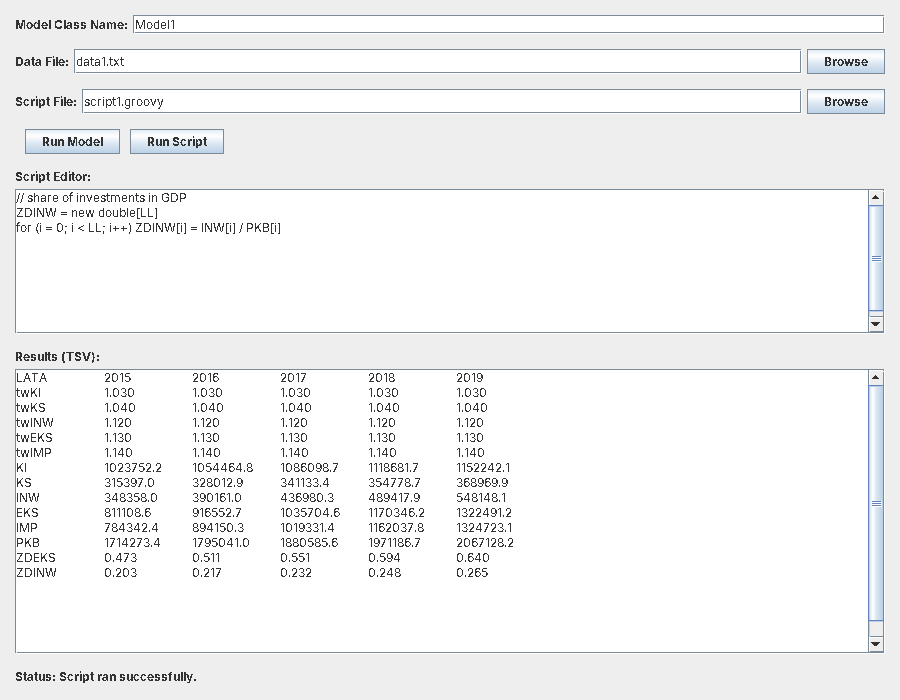

# Economic Model Simulator

A desktop tool for running economic forecasting models and extending them with **Groovy scripts** at runtime.
Built with Java Swing, Java Reflection, custom annotations and the `javax.script` API.



## How it works

1. **Model:** a plain Java class whose fields are marked with the `@Bind` annotation (see `Model1`).
   It forecasts GDP (`PKB`) from private consumption, public consumption, investments, export and import, each growing at its own yearly rate.
2. **Controller:** finds `@Bind` fields with **reflection**, fills them from a data file, runs the model and reads the results back.
3. **Scripts:** any Groovy script can use the model variables and define new ones. For example, export share in GDP:
   ```groovy
   ZDEKS = new double[LL]
   for (i = 0; i < LL; i++) ZDEKS[i] = EKS[i] / PKB[i]
   ```
   New arrays created by the script are added to the results automatically (single-letter variables like `i` are ignored).
4. **GUI:** choose a model, data file and script (or type one in the editor) and see the results as a table.

## Data file format

The first line lists the years, the rest are variables with values per year. If fewer values are given than years, the last value is repeated.

```
LATA    2015 2016 2017 2018 2019
twKI    1.03
KI      1023752.2
...
```

## Project structure

```
src/
├── Bind.java            # @Bind annotation for model fields
├── Model1.java          # GDP forecasting model
├── Controller.java      # reflection-based binding, model & script execution
├── SimulationGUI.java   # Swing interface
├── data1.txt, data2.txt # sample input data
└── script1.groovy       # sample script (export share in GDP)
```

## Running

Requires JDK 17+ and Maven.

```bash
mvn compile exec:java
```

In the window enter `Model1` as the model name, choose `src/data1.txt` as the data file and optionally `src/script1.groovy`, then click **Run Script**.

Or open the folder in IntelliJ IDEA (it will import `pom.xml`) and run `SimulationGUI`, using the `src` folder as the working directory.
